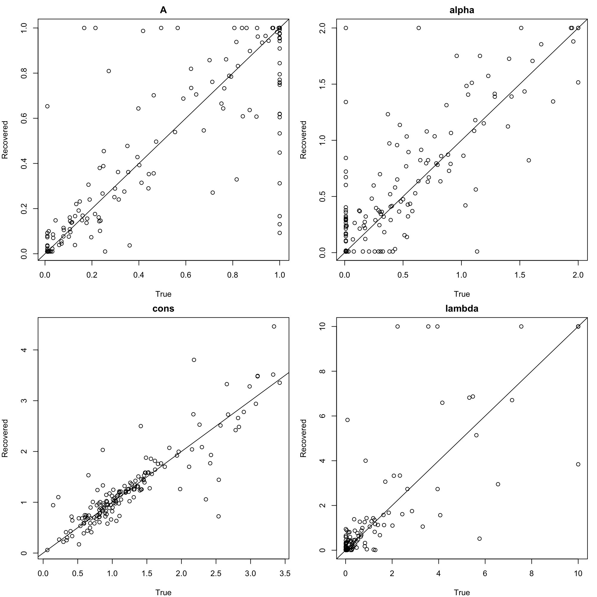
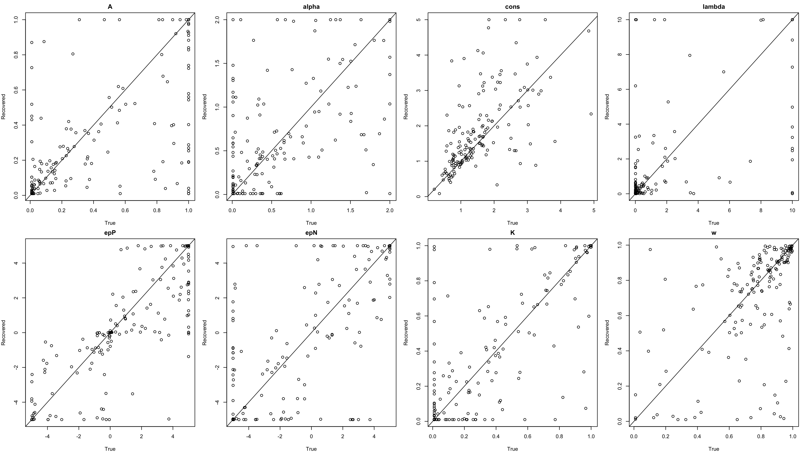
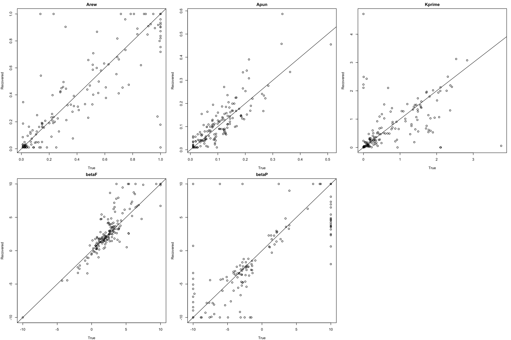
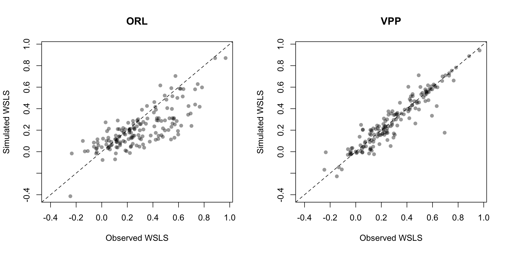

# Reinforcement-learning models of the Iowa Gambling Task

I implemented three reinforcement-learning models of the Iowa Gambling Task
(PVL-Delta, VPP, and ORL) in R from their published equations and fit them
to 162 healthy adults by maximum likelihood. I then compared the models
(AIC/BIC), ran parameter recovery, and checked whether each model could
reproduce participants’ win-stay/lose-shift behavior. ORL fit best overall,
but it under-produced win-stay/lose-shift, which VPP reproduced. Next,
I plan to test an ORL variant whose perseveration depends on whether the
last outcome was a gain or a loss.

**Status:** Personal learning project, October 2026.

## What's in this repository

- Implementations of three reinforcement-learning models of the IGT (PVL-Delta, VPP, ORL), each with a likelihood function, a simulator, and a multi-start maximum-likelihood fitting routine
- Fits to 162 healthy adults from a public data pool
- Parameter recovery for all three models
- Model comparison (AIC/BIC), sensitivity checks on parameter limits, and a generative check of win-stay/lose-shift behavior

## Background

Back in 1994, Bechara et al. wanted to figure out a way to assess decision making deficits in people with ventromedial prefrontal damage who despite normal intelligence, displayed poor decision making. To do this they developed The Iowa Gambling Task. The scheme goes as follows:

The participant would be given $2000 of facsimile money. They would then be shown four decks of cards; they choose one deck and pick one card from said deck at a time. Each card gives a reward (rew), with some also carrying a loss/punishment (pun). Their instructions are to make as much money as possible while not being told deck properties. Over every ten cards, decks A & B both have a -250 expected outcome (losing decks), while decks C & D have expected outcome of +250 (winning decks). The paired decks varied in both how often pun was doled out & how much any given pun is worth. For losing decks, rew was fixed at +100 while pun varied between -150 to -350 for deck A and was fixed at -1250 for deck B. For winning decks, rew was fixed at +50 while pun varied between -25 to -75 for deck C and was fixed at -250 for deck D. Every card has a rew, but decks A & C carry a pun on 5 of every 10 cards, while B & D carry one on only 1 of every 10. Participants are assessed on ability to favor winning decks over the losing ones.

Summary scores like the net score (C+D-A-B) can't tell apart people who reach the same score through different means, e.g. faster vs. slower learning or more versus less consistent choosing. To address this, computational modeling is used. These models assume that following each trial, participants update their expectations about the decks. The models I coded build on the Expectancy Valence model (Busemeyer & Stout, 2002) and Prospect Valence Learning (PVL; Ahn et al., 2008).

## Models

**Prospect Valence Learning With The Delta Rule (PVL-Delta)** (Ahn et al., 2008): It assumes people feel outcomes through a prospect-utility function (α: how sensitivity changes with outcome size; below 1, each extra dollar counts for less; λ: how much losses count relative to gains), update the chosen deck's expected value (EV) toward each felt outcome at learning rate A, & choose decks through a softmax whose consistency c sets how strictly choices follow value. Four parameters: A, α, λ, c.

**Value-Plus-Perseveration (VPP)** (Worthy, Pang & Byrne, 2013): Separates the tendency to repeat recent choices from the tendency to choose high-value decks. It keeps PVL-Delta's utility function, learning rule, and softmax, and adds a second quantity for each deck: "perseveration", a pull toward or away from recently chosen decks that depends on which deck was chosen & whether the outcome was a gain or a loss, not on the outcome's size. Every deck's perseveration fades (decays) over trials at some rate K (near 1: a long memory of past choices; near 0: only the last choice matters), & the chosen deck's perseveration is boosted after gains (ε_P) or losses (ε_N). Either boost can be negative, pushing toward a switch, so ε_P > 0 with ε_N < 0 is win-stay, lose-shift. VPP then combines EV and perseveration into one value signal that replaces EV in the softmax. This adds a parameter w, which sets the weight given to each: at w = 1, VPP is exactly PVL-Delta, & at w = 0, choices follow perseveration alone. The model increases parameter count to eight: A, α, λ, c, K, ε_P, ε_N, w.

**Outcome-Representation Learning (ORL)** (Haines, Vassileva & Ahn, 2018): ORL starts clean, keeping only the delta rule, softmax & a modified version of perseveration. ORL introduces sensitivity to win frequency (how often a deck pays off) and distinguishes it from how much a deck pays (e.g., deck B, a losing deck, is often picked as much as the winning decks because it rarely produces a loss). ORL learns expected value (EV) directly from the objective outcome, with one learning rate after gains (A_rew) and another after losses (A_pun). Alongside EV, ORL learns each deck's expected frequency (EF) from the outcome's sign alone (+1 for a gain, −1 for a loss), ignoring size. EF also gets a fictive update for the unchosen decks: if the chosen deck won, ORL assumes the others probably would have lost, & vice versa. Unlike VPP's, ORL's perseveration ignores outcomes: every deck's pull fades each trial by K, & the chosen deck is reset to the same value whether it won or lost. Finally, expected value, win frequency, & perseveration are added into one value signal, where two new parameters, βF and βP set how much frequency and perseveration count. This goes into a softmax with no consistency parameter (θ fixed at 1), so βF and βP are measured relative to expected value. It cuts the parameter count to five: A_rew, A_pun, K, βF, βP.

| Model | Parameters (range used) | Source |
|---|---|---|
| PVL-Delta | A (0.01–1), α (0.01–2), c (0.01–5), λ (0.01–10) | Ahn et al. (2008) |
| VPP | PVL-Delta's four, plus ε_P, ε_N (−5 to 5), K (0.01–1), w (0.01–1) | Worthy, Pang & Byrne (2013) |
| ORL | A_rew, A_pun (0.01–1), K′ (0–5), βF, βP (−10 to 10) | Haines, Vassileva & Ahn (2018) |

Implementation notes:
- Equations follow Haines et al. (2018). My ORL code was written from the published equations and checked against the hBayesDM Stan implementation (`igt_orl.stan`); no code was copied.
- Outcomes are divided by 100 (hBayesDM's default scale), so estimates are comparable to hBayesDM's.
- The papers leave VPP's ε and ORL's β parameters unbounded; the limits above are my choice (see "Sensitivity to parameter limits").
- ORL's decay K is fitted on a transformed scale, K′, with K = 3^K′ − 1 (following hBayesDM); K′ is what the tables and figures report.

## Data

Studies use different trial lengths & payoff schemes. I used the Horstmann dataset from Steingroever et al.'s (2015) "many labs" data pool (https://osf.io/8t7rm, CC BY-SA 4.0): 162 healthy participants, 100 trials each. These data were first published in Steingroever et al. (2013), and a subset appears in Horstmann, Villringer & Neumann (2012). Its payoffs match the original except for deck C, whose pun is always -50 rather than varying between -25 & -75, so the expected outcomes stay the same; the card order is also randomly shuffled rather than fixed (payoff scheme 2 in the data paper). For every trial, the chosen deck and net outcome was given, as (gain + loss, with loss stored as negative numbers).

The data are **not** included in this repository. To run the code, download `IGTdata.rdata` from OSF and place it in a folder named `data-raw/` in the project root.

## Methods

**Model Fitting:** I fit each model separately to each participant by maximum likelihood. For a given set of parameters, the model assigns a probability (via softmax) to the deck the participant chose on each trial; the likelihood is the product of those 100 probabilities, then I searched for the parameters that made the observed sequence of choices most probable. This was done by summing the log-probabilities instead of multiplying the probabilities. This was done because a product of 100 small numbers shrinks toward 0, and minimized the negative of that sum (the negative log-likelihood (nll)). The log-softmax was computed by subtracting the largest value before exponentiating, that way large values don't overflow.

I used R's "optim" with the L-BFGS-B method, which allows bounds on each parameter, and ran it from 20 random starting points per participant (50 for VPP), keeping the best fit, because the likelihood surface can have local minima that trap a single search. VPP's iteration limit was raised to 1,000 because its fits were stopping before converging under the original 100. Lower bounds were set to 0.01 rather than 0 because at A = 0 & c = 0 the likelihood surface is flat, and the optimizer stopped there at chance-level fits. For reference, a participant choosing at random has an nll of 100 x ln 4 ≈ 138.63. The random seed was set at "2026" for ease of memory. As checks on the code, I confirmed that each likelihood returns 138.63 when its parameters make every choice equally likely, and that VPP never fit a participant worse than PVL-Delta (it can't, since w = 1 reproduces PVL-Delta exactly). Of the 486 best fits (162 participants × 3 models), 5 ended with optim's code 52 (the line search stopped without confirming convergence) rather than 0: 1 for PVL-Delta, 2 for VPP, and 2 for ORL.

**Model Comparison:** I compared models with AIC = 2·nll + 2k and BIC = 2·nll + k·ln(n), where k = # of parameters (4 for PVL-Delta, 8 for VPP, 5 for ORL) and n = 100 trials per participant. Both start from how well the model fits (2·nll) and add a penalty for each parameter; (lower = better). Each was summed across participants, I also noted which model won for each participant under each criterion. I used two methods because BIC charges ~4.6 per parameter instead of 2, so it penalizes VPP's eight parameters more heavily. Reporting both tells me whether the ranking depends on that choice.

**Parameter Recovery:** Each participant's fitted parameters were called "true" values and used to simulate synthetic participants. Simulated outcomes were drawn at random from the outcomes actually observed for each deck. The synthetic data were refit with the same procedure. True & recovered values were compared with Pearson & Spearman correlations and counted how many estimates landed on a bound.

**Bound Sensitivity Checks:** Participants whose perseveration estimates landed on a "bound" (limit) were refit with wider bounds (ORL βP: ±10 → ±30; VPP ε_P and ε_N: ±5 → ±15). I compared their nll before and after and checked whether the model ranking changed, to see whether the bounds I chose for the perseveration parameters were constraining the fits.

**Generative Check:** A model can fit choices well overall and still fail to reproduce a specific behavior, so I checked whether ORL & VPP reproduce win-stay/lose-shift (WSLS), defined as P(stay after gain) - P(stay after loss), with outcomes of 0 counted as gains. For each participant, I simulated 20 datasets from their fitted parameters, computed WSLS for each, and averaged them. I compared observed and simulated WSLS across participants with a correlation and a paired t-test.

**Software:** R 4.6.1 (in RStudio) was used for all analyses, with optim from R's built-in stats package, and renv to record package versions so the analysis can be rerun with the same setup. The code for each step is in "scripts/", numbered in the order the scripts run.

## Results

### Behavior

Across all 100 trials, participants chose deck A on 14.5% of trials, B on 34.8%, C on 20.1%, and D on 30.5%. The winning decks (C & D) received only about half of all choices (50.6%), while the two decks that rarely produce a loss (B & D) received about two thirds (65.3%); deck B, a losing deck, was chosen most often. Observed win-stay/lose-shift averaged 0.30 (median 0.26).

### Model comparison

| | PVL-Delta | VPP | ORL |
|---|---|---|---|
| Parameters | 4 | 8 | 5 |
| Median nll per participant | 115.7 | 98.8 | 102.5 |
| Total AIC | 36,730 | 33,190 | **33,099** |
| Total BIC | 38,418 | 36,566 | **35,209** |
| Best model, by participant (AIC) | 14 | 64 | 84 |
| Best model, by participant (BIC) | 33 | 18 | 111 |

ORL fit best on both criteria: BIC was decisive (a gap of 1,357 over VPP),
while AIC’s gap was much smaller (91, about 0.6 per participant). 
VPP actually fits the choices better in raw terms (summed nll 440.7 lower than ORL’s),
but not by enough to justify its three extra parameters.
PVL-Delta was worst on both. One last observation: 
different people are best fit by different models;
under AIC, ORL won for 84 participants, VPP for 64, and PVL-Delta for 14.

### Parameter recovery

Correlation between true and recovered values (Pearson / Spearman), 162 simulated participants per model.

| Model | Parameter recovery |
|---|---|
| PVL-Delta | A .83/.82, α .81/.75, c .89/.88, λ .81/.78 |
| VPP | A .63/.63, α .53/.54, c .59/.67, λ .59/.59, ε_P .80/.83, ε_N .70/.66, K .75/.69, w .57/.60 |
| ORL | A_rew .87/.86, A_pun .86/.86, K′ .55/.67, βF .87/.84, βP .85/.85 |

**PVL-Delta**

**VPP**

**ORL**

*Each point is one simulated participant; the line marks perfect recovery. Columns of points at a plot's edge are estimates sitting at a parameter limit.*

PVL-Delta & ORL recovered well, except for ORL’s K′ (Pearson r = .55, Spearman ρ = .67), likely due to the trade-off between βP & K;
this is consistent with Haynes et al. (2024), who removed K from their ORL for the play-or-pass IGT because it recovered poorly.
VPP’s extra parameters made the parameters it shares with PVL-Delta (A, α, c, λ) harder to recover (.53–.67, vs. .75–.89 in PVL-Delta),
likely because w trades off with c and A. As seen on the recovery plots,
many estimates sit at a bound (e.g., 87 of 162 VPP λ values and 65 ORL βP values).
For participants at the limit, βP recovers its sign better than its size.

### Sensitivity to parameter limits

| | Participants at limit | Wider limit | Total nll gain | Searches that did worse |
|---|---|---|---|---|
| ORL βP | 65 | ±10 → ±30 | 30.6 | 4 |
| VPP ε_P/ε_N | 69 | ±5 → ±15 | 2.6 | 10 |

Widening the limits barely changed the fits (total nll gains of 30.6 for ORL and 2.6 for VPP)
and didn’t change the model ranking, so the limits didn’t drive the comparison.
Participants at the βP limit had higher K′ than the other participants (median 1.49 vs. 0.25),
likely because when perseveration fades fast, it needs a large weight to affect choices at all.

### Generative check: win-stay/lose-shift

| | Mean | Median | Correlation with observed |
|---|---|---|---|
| Observed | 0.30 | 0.26 | – |
| ORL simulated | 0.21 | 0.18 | .77 |
| VPP simulated | 0.29 | 0.24 | .93 |

ORL under-produces win-stay/lose-shift (paired difference 0.085, 95% CI [0.06, 0.11], t(161) = 7.2, p < .001;
observed exceeds simulated for 71% of participants). VPP does not differ reliably from observed
(mean difference 0.007, 95% CI [−0.006, 0.021], t(161) = 1.06, p = .29;
observed exceeds simulated for 56% of participants).

ORL tracks who has high or low WSLS (r = .77) but underpredicts how much (mean 0.21 vs. 0.30 observed),
and the gap grows for participants with strong WSLS. VPP, whose perseveration depends on whether
the last outcome was a gain or a loss, reproduces both: who has high or low WSLS (r = .93)
and how much (0.29 vs. 0.30).

Overall, ORL is the best account of these choices: it wins on both total AIC and BIC,
and most of its parameters recover well. But it misses win-stay/lose-shift, which VPP reproduces.
A likely reason is that VPP’s perseveration depends on whether the last outcome was a gain or a loss,
while ORL’s ignores outcomes. Testing that explanation, by adding outcome-dependent perseveration to ORL,
is the planned extension below.

## Limitations

1. There are issues of heterogeneity: many healthy participants never learn to favor the winning decks (Steingroever et al., 2013; here, the winning decks received only 50.6% of all choices), but we still use it regularly to assess decision-making deficits. This should make us question our belief in the test's validity.
2. I used per-participant maximum likelihood rather than a hierarchical estimation.
3. I only refit perseveration parameters with wider limits, there were cases (e.g., VPP λ and A) that were not rechecked.
4. The simulator function used draws outcomes at random from each deck rather than using the task's actual card sequence.
5. AIC & BIC count parameters rather than assessing the model's actual flexibility.
6. No model recovery was assessed (simulating data from each model and checking whether AIC & BIC pick the model that generated it), so I can't yet confirm the comparison can tell these models apart.
7. I used one dataset of healthy adults, so the results may not hold for clinical groups or other payoff schemes.

## Planned extension: outcome-dependent perseveration in ORL

**Motivation:** ORL fit best by total AIC & BIC, but its perseveration ignores outcomes,
and it underpredicts how much participants stay after gains and switch after losses (win-stay, lose-shift).
VPP, whose perseveration depends on whether the last outcome was a gain or a loss, comes much closer (see "Generative check").

**Proposed variant:** What I want to work on next is an ORL variant that splits perseveration into separate traces after gains and after losses, each with its own weight (βP_win, βP_loss); it reduces to ORL when the two weights are equal (6 parameters vs. 5).

**Predictions** (written before fitting):
1. The variant beats ORL on summed AIC & BIC.
2. βP_win > βP_loss for most participants.
3. It reproduces the observed win-stay, lose-shift.
4. Its new parameters recover acceptably (otherwise prediction 2 can't be interpreted).

**Test sample:** The hypothesis came from the Horstmann data, so the confirmatory test uses
a held-out study from the same pool with the same task: Steingroever et al.
(in preparation, listed in the 2015 data paper), N = 70, 100 trials, payoff scheme 2 (labeled `SteingroverInPrep` in the data file).

**Status:** written October 18, 2026, before any variant code or fitting. Not a formal preregistration,
since the discovery data had already been analyzed.

## Next steps

- Model recovery for the three models
- Hierarchical Bayesian fits with hBayesDM as a cross-check, with LOOIC
- The extension above
- I'm also planning on comparing it against newer models.

## How to run

R 4.6.1. Package versions are recorded with renv: open the project in RStudio and run `renv::restore()`. Then run the scripts in `scripts/` in numbered order. Each script loads what it needs from earlier ones, and results are saved to `output/` so later scripts don't refit.

| Script | What it does | Approx. time* |
|---|---|---|
| `01_load_data.R` | Loads the data pool, selects the Horstmann participants, computes net outcomes | seconds |
| `02_pvl_delta.R` | PVL-Delta likelihood, simulator, and fitting function | seconds |
| `03_vpp.R` | VPP likelihood, simulator, and fitting function | seconds |
| `04_orl.R` | ORL likelihood, simulator, and fitting function | seconds |
| `05_fit_models.R` | Fits all three models to all participants; ORL parameter-limit check | ~1.5 hours |
| `05b_vpp_limit_check.R` | VPP parameter-limit check | ~15 min |
| `06_recovery.R` | Parameter recovery for all three models | ~30 min |
| `07_model_comparison.R` | AIC/BIC model comparison | seconds |
| `08_wsls_check.R` | Win-stay/lose-shift: observed vs. simulated from fitted models | ~1 min |

*On an Apple silicon MacBook Air.

## How this project was built

Goals:
- Teach myself how to code in R
- Understand how scientists use computational methods in research relating to Computational Psychology

Assistance:
I used Anthropic's Opus 5.5 on Extra as a tutor: it explained the models' equations and R syntax,
reviewed my code for errors, and helped edit this write-up. I implemented the three models from their published equations
(Ahn et al., 2008; Worthy, Pang & Byrne, 2013; Haines, Vassileva & Ahn, 2018), following hBayesDM's outcome scaling and consulting
its ORL code (Ahn, Haines & Zhang, 2017). I wrote and ran the code myself in RStudio.

## References

- Ahn, W.-Y., Busemeyer, J. R., Wagenmakers, E.-J., & Stout, J. C. (2008). Comparison of decision learning models using the generalization criterion method. *Cognitive Science, 32*(8), 1376–1402. https://doi.org/10.1080/03640210802352992
- Ahn, W.-Y., Haines, N., & Zhang, L. (2017). Revealing neurocomputational mechanisms of reinforcement learning and decision-making with the hBayesDM package. *Computational Psychiatry, 1*, 24–57. https://doi.org/10.1162/CPSY_a_00002
- Bechara, A., Damasio, A. R., Damasio, H., & Anderson, S. W. (1994). Insensitivity to future consequences following damage to human prefrontal cortex. *Cognition, 50*(1–3), 7–15. https://doi.org/10.1016/0010-0277(94)90018-3
- Busemeyer, J. R., & Stout, J. C. (2002). A contribution of cognitive decision models to clinical assessment: Decomposing performance on the Bechara gambling task. *Psychological Assessment, 14*(3), 253–262. https://doi.org/10.1037/1040-3590.14.3.253
- Haines, N., Vassileva, J., & Ahn, W.-Y. (2018). The Outcome-Representation Learning model: A novel reinforcement learning model of the Iowa Gambling Task. *Cognitive Science, 42*(8), 2534–2561. https://doi.org/10.1111/cogs.12688
- Haynes, J. M., Haines, N., Sullivan-Toole, H., & Olino, T. M. (2024). Test-retest reliability of the play-or-pass version of the Iowa Gambling Task. *Cognitive, Affective, & Behavioral Neuroscience, 24*(4), 740–754. https://doi.org/10.3758/s13415-024-01197-6
- Horstmann, A., Villringer, A., & Neumann, J. (2012). Iowa Gambling Task: There is more to consider than long-term outcome. Using a linear equation model to disentangle the impact of outcome and frequency of gains and losses. *Frontiers in Neuroscience, 6*, 61. https://doi.org/10.3389/fnins.2012.00061
- Steingroever, H., Wetzels, R., Horstmann, A., Neumann, J., & Wagenmakers, E.-J. (2013). Performance of healthy participants on the Iowa Gambling Task. *Psychological Assessment, 25*(1), 180–193. https://doi.org/10.1037/a0029929
- Steingroever, H., et al. (2015). Data from 617 healthy participants performing the Iowa Gambling Task: A "many labs" collaboration. *Journal of Open Psychology Data, 3*(1), e5. https://doi.org/10.5334/jopd.ak
- Worthy, D. A., Pang, B., & Byrne, K. A. (2013). Decomposing the roles of perseveration and expected value representation in models of the Iowa Gambling Task. *Frontiers in Psychology, 4*, 640. https://doi.org/10.3389/fpsyg.2013.00640

## License

MIT License: see `LICENSE`. The data are not included and keep their own OSF license (CC BY-SA 4.0).