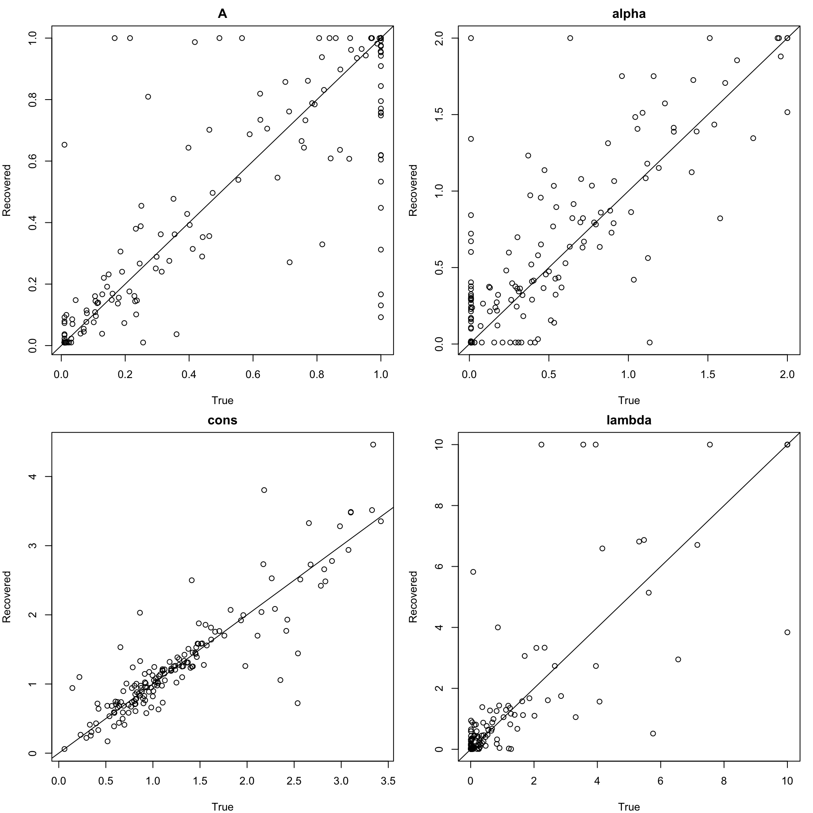
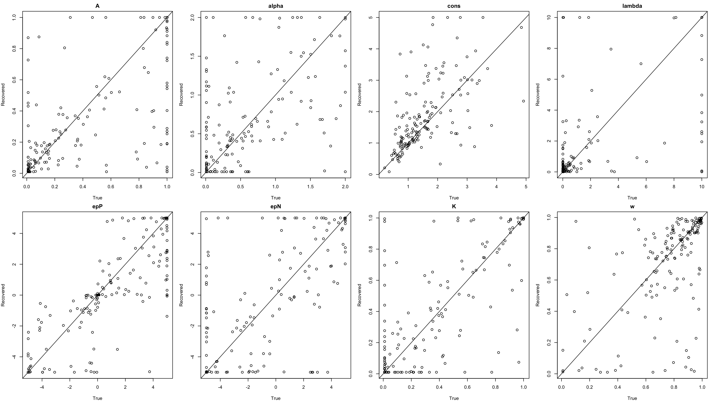
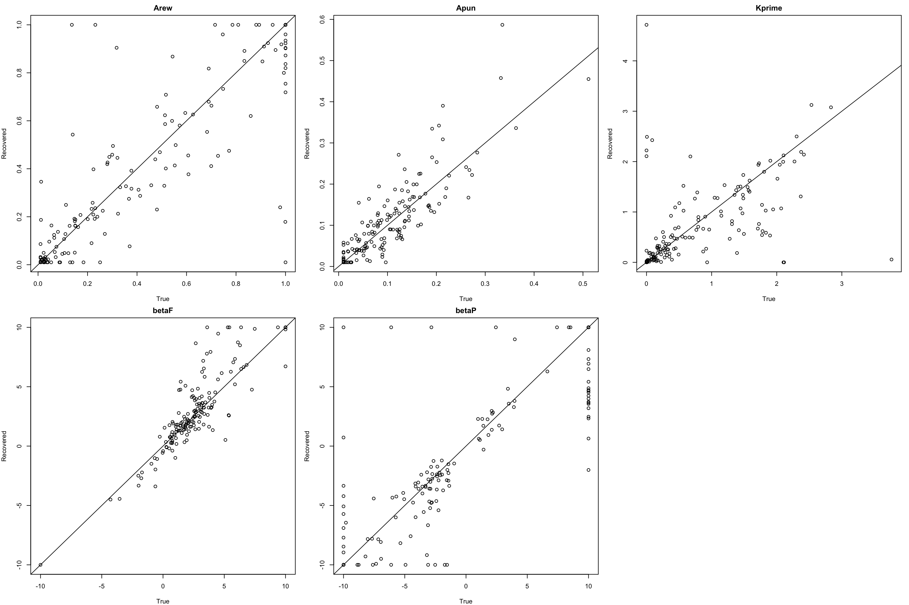
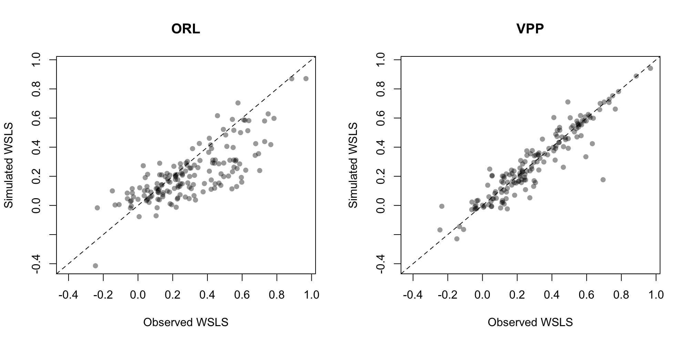
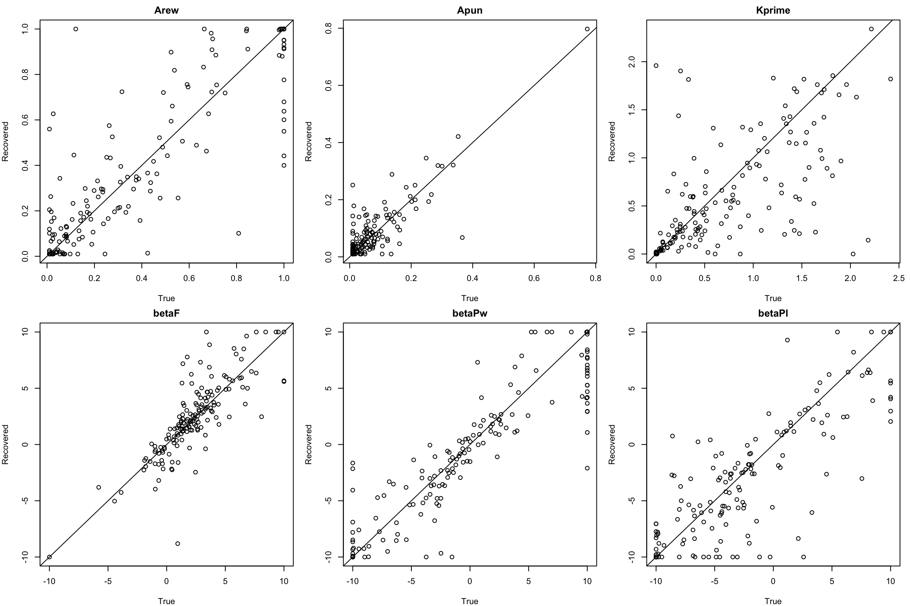
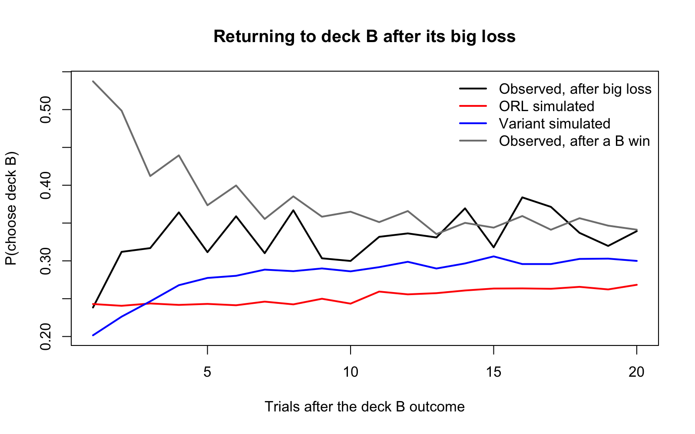

# Reinforcement-learning models of the Iowa Gambling Task

I implemented three reinforcement-learning models of the Iowa Gambling Task
(PVL-Delta, VPP, and ORL) in R from their published equations and fit them
to 162 healthy adults by maximum likelihood. I then compared the models
(AIC/BIC), ran parameter recovery, and checked whether each model could
reproduce participants’ win-stay/lose-shift behavior. Of the three, ORL fit best overall,
but it under-produced win-stay/lose-shift, which VPP reproduced. I then built
an ORL variant whose perseveration depends on whether the last outcome was gain
or loss. On the same data, it beat ORL on summed AIC (not BIC), reproduced win-stay/lose-shift,
and its new parameters recovered well. On a held-out sample of 70 participants,
with predictions written before fitting, it again beat ORL on AIC (BIC was nearly tied),
reproduced win-stay/lose-shift where ORL did not, and 81% of participants showed a stronger
pull toward the last deck after gains than after losses; 4 of 5 predictions were met.
A hierarchical (Stan) version of the variant shows the same asymmetry at the group level, and in cross-validation of
the hierarchical models (run on Baylor's Kodiak cluster), the variant predicted held-out choices better than ORL by more
than 5 SE, meeting a prediction written before the run.

**Status:** Personal learning project, ongoing (last updated November 6, 2026).

## What's in this repository

- Implementations of three reinforcement-learning models of the IGT (PVL-Delta, VPP, ORL),
each with a likelihood function, a simulator, and a multi-start maximum-likelihood fitting routine
- Fits to 162 healthy adults from a public data pool
- Parameter recovery for all three models
- Model comparison (AIC/BIC), sensitivity checks on parameter limits, and a generative check of
win-stay/lose-shift behavior
- An ORL variant with outcome-dependent perseveration: fits, model recovery against ORL,
parameter recovery, win-stay/lose-shift check, and a confirmatory test on a held-out sample
- Hierarchical Bayesian cross-checks: hBayesDM fits of the three original models, and a Stan version of the variant
- Cross-validation of the hierarchical ORL and variant, run on Baylor's Kodiak cluster
- An exploratory analysis of how people return to deck B after its big loss

## Background

Back in 1994, Bechara et al. wanted to figure out a way to assess decision making
deficits in people with ventromedial prefrontal damage who despite normal intelligence,
displayed poor decision making. To do this they developed the Iowa Gambling Task.
The scheme goes as follows:

The participant would be given $2000 of facsimile money. They would then be shown four
decks of cards; they choose one deck and pick one card from said deck at a time. Each
card gives a reward (rew), with some also carrying a loss/punishment (pun). Their
instructions are to make as much money as possible while not being told deck properties.
Over every ten cards, decks A & B both have a -250 expected outcome (losing decks),
while decks C & D have expected outcome of +250 (winning decks). The paired decks varied
in both how often pun was doled out & how much any given pun is worth. For losing decks,
rew was fixed at +100 while pun varied between -150 to -350 for deck A and was fixed at
-1250 for deck B. For winning decks, rew was fixed at +50 while pun varied between -25
to -75 for deck C and was fixed at -250 for deck D. Every card has a rew, but decks A & C
carry a pun on 5 of every 10 cards, while B & D carry one on only 1 of every 10. Participants
are assessed on ability to favor winning decks over the losing ones.

Summary scores like the net score (C+D-A-B) can't tell apart people who reach the same score
through different means, e.g. faster vs. slower learning or more versus less consistent choosing.
To address this, computational modeling is used. These models assume that following each trial,
participants update their expectations about the decks. The models I coded build on the Expectancy
Valence model (Busemeyer & Stout, 2002) and Prospect Valence Learning (PVL; Ahn et al., 2008).

## Models

**Prospect Valence Learning With The Delta Rule (PVL-Delta)** (Ahn et al., 2008):
It assumes people feel outcomes through a prospect-utility function (α: how sensitivity
changes with outcome size; below 1, each extra dollar counts for less; λ: how much losses count
relative to gains), update the chosen deck's expected value (EV) toward each felt outcome at
learning rate A, & choose decks through a softmax whose consistency c sets how strictly choices
follow value. Four parameters: A, α, λ, c.

**Value-Plus-Perseveration (VPP)** (Worthy, Pang & Byrne, 2013):
Separates the tendency to repeat recent choices from the tendency to choose high-value decks.
It keeps PVL-Delta's utility function, learning rule, and softmax, and adds a second quantity
for each deck: "perseveration", a pull toward or away from recently chosen decks that depends
on which deck was chosen & whether the outcome was a gain or a loss, not on the outcome's size.
Every deck's perseveration fades (decays) over trials at some rate K (near 1: a long memory of
past choices; near 0: only the last choice matters), & the chosen deck's perseveration is boosted
after gains (ε_P) or losses (ε_N). Either boost can be negative, pushing toward a switch, so ε_P > 0
with ε_N < 0 is win-stay, lose-shift. VPP then combines EV and perseveration into one value signal
that replaces EV in the softmax. This adds a parameter w, which sets the weight given to each:
at w = 1, VPP is exactly PVL-Delta, & at w = 0, choices follow perseveration alone. The model increases
parameter count to eight: A, α, λ, c, K, ε_P, ε_N, w.

**Outcome-Representation Learning (ORL)** (Haines, Vassileva & Ahn, 2018):
ORL starts clean, keeping only the delta rule, softmax & a modified version of perseveration.
ORL introduces sensitivity to win frequency (how often a deck pays off) and distinguishes it
from how much a deck pays (e.g., deck B, a losing deck, is often picked as much as the winning
decks because it rarely produces a loss). ORL learns expected value (EV) directly from the objective
outcome, with one learning rate after gains (A_rew) and another after losses (A_pun). Alongside EV,
ORL learns each deck's expected frequency (EF) from the outcome's sign alone (+1 for a gain, −1 for a loss),
ignoring size. EF also gets a fictive update for the unchosen decks: if the chosen deck won, ORL assumes
the others probably would have lost, & vice versa. Unlike VPP's, ORL's perseveration ignores outcomes:
every deck's pull fades each trial by K, & the chosen deck is reset to the same value whether it won or
lost. Finally, expected value, win frequency, & perseveration are added into one value signal, where two
new parameters, βF and βP set how much frequency and perseveration count. This goes into a softmax with
no consistency parameter (θ fixed at 1), so βF and βP are measured relative to expected value. It cuts
the parameter count to five: A_rew, A_pun, K, βF, βP.

| Model | Parameters (range used) | Source |
|---|---|---|
| PVL-Delta | A (0.01–1), α (0.01–2), c (0.01–5), λ (0.01–10) | Ahn et al. (2008) |
| VPP | PVL-Delta's four, plus ε_P, ε_N (−5 to 5), K (0.01–1), w (0.01–1) | Worthy, Pang & Byrne (2013) |
| ORL | A_rew, A_pun (0.01–1), K′ (0–5), βF, βP (−10 to 10) | Haines, Vassileva & Ahn (2018) |
| ORL variant | ORL's, with βP split into βP_win, βP_loss (−10 to 10) | This project (see Extension) |

Implementation notes:
- Equations follow Haines et al. (2018). My R code for all three models was written from the published
equations; my ORL code was checked against the hBayesDM Stan implementation (`igt_orl.stan`), and no R code was copied.
- The Stan files in `stan/` are different: they are modified copies of hBayesDM's `igt_orl.stan` (GPL-3),
and each file's header says what I changed.
- Outcomes are divided by 100 (hBayesDM's default scale), so estimates are comparable to hBayesDM's.
- The papers leave VPP's ε and ORL's β parameters unbounded; the limits above are my choice
(see "Sensitivity to parameter limits").
- ORL's decay K is fitted on a transformed scale, K′, with K = 3^K′ − 1 (following hBayesDM);
K′ is what the tables and figures report.

## Data

Studies use different trial lengths & payoff schemes. I used the Horstmann dataset
from Steingroever et al.'s (2015) "many labs" data pool (https://osf.io/8t7rm, CC BY-SA 4.0):
162 healthy participants, 100 trials each. These data were first published in Steingroever et al. (2013),
and a subset appears in Horstmann, Villringer & Neumann (2012). Its payoffs match the original except for
deck C, whose pun is always -50 rather than varying between -25 & -75, so the expected outcomes stay the
same; the card order is also randomly shuffled rather than fixed (payoff scheme 2 in the data paper).
For every trial, the data give the chosen deck and the net outcome (gain + loss, with losses stored as negative numbers).

The held-out test (see Extension) uses a second study from the same pool and file: SteingroverInPrep
(Steingroever et al., in preparation, listed in the 2015 data paper), 70 participants, 100 trials, payoff scheme 2.

The data are **not** included in this repository. To run the code, download
`IGTdata.rdata` from OSF and place it in a folder named `data-raw/` in the project root.

## Methods

**Model Fitting:** I fit each model separately to each participant by maximum likelihood.
For a given set of parameters, the model assigns a probability (via softmax)
to the deck the participant chose on each trial; the likelihood is the product
of those 100 probabilities, then I searched for the parameters that made the observed
sequence of choices most probable. This was done by summing the log-probabilities instead of
multiplying the probabilities. This was done because a product of 100 small numbers shrinks
toward 0, and minimized the negative of that sum (the negative log-likelihood (nll)).
The log-softmax was computed by subtracting the largest value before exponentiating,
that way large values don't overflow.

I used R's "optim" with the L-BFGS-B method, which allows bounds on each parameter,
and ran it from 20 random starting points per participant (50 for VPP), keeping the best
fit, because the likelihood surface can have local minima that trap a single search. VPP's
iteration limit was raised to 1,000 because its fits were stopping before converging under
the original 100. Lower bounds were set to 0.01 rather than 0 because at A = 0 & c = 0 the
likelihood surface is flat, and the optimizer stopped there at chance-level fits. For reference,
a participant choosing at random has an nll of 100 x ln 4 ≈ 138.63. The random seed was set at
"2026" for ease of memory. As checks on the code, I confirmed that each likelihood returns 138.63
when its parameters make every choice equally likely, and that VPP never fit a participant worse
than PVL-Delta (it can't, since w = 1 reproduces PVL-Delta exactly). Of the 486 best fits
(162 participants × 3 models), 5 ended with optim's code 52 (the line search stopped without confirming
convergence) rather than 0: 1 for PVL-Delta, 2 for VPP, and 2 for ORL.

**Model Comparison:** I compared models with AIC = 2·nll + 2k and BIC = 2·nll + k·ln(n),
where k = number of parameters (4 for PVL-Delta, 8 for VPP, 5 for ORL) and n = 100 trials
per participant. Both start from how well the model fits (2·nll) and add a penalty for each
parameter; (lower = better). Each was summed across participants, I also noted which model
won for each participant under each criterion. I used two methods because BIC charges ~4.6
per parameter instead of 2, so it penalizes VPP's eight parameters more heavily. Reporting
both tells me whether the ranking depends on that choice.

**Parameter Recovery:** Each participant's fitted parameters were called "true" values
and used to simulate synthetic participants. Simulated outcomes were drawn at random
from the outcomes actually observed for each deck. The synthetic data were refit with
the same procedure. True & recovered values were compared with Pearson & Spearman
correlations and counted how many estimates landed on a bound.

**Model Recovery:** To check whether the comparison can tell the models apart,
I simulated one synthetic participant per real participant from each model
(using that participant's fitted parameters with outcomes drawn as in parameter
recovery), then fit the three models to the simulated datasets with the same
procedure, and recorded which model AIC & BIC picked, per participant then summed
(486 datasets).

**Bound Sensitivity Checks:** Participants whose perseveration estimates landed
on a "bound" (limit) were refit with wider bounds (ORL βP: ±10 → ±30; VPP ε_P and ε_N: ±5 → ±15).
I compared their nll before and after and checked whether the model ranking changed, to see whether
the bounds I chose for the perseveration parameters were constraining the fits.

**Generative Check:** A model can fit choices well overall and still fail to reproduce
a specific behavior, so I checked whether ORL & VPP reproduce win-stay/lose-shift (WSLS),
defined as P(stay after gain) - P(stay after loss), with outcomes of 0 counted as gains.
For each participant, I simulated 20 datasets from their fitted parameters, computed WSLS
for each, and averaged them. I compared observed and simulated WSLS across participants with
a correlation and a paired t-test.

**Software:** R 4.6.1 (in RStudio) was used for all analyses, with optim from R's built-in stats package,
hBayesDM 2.0.1 and cmdstanr 0.9.0 (CmdStan 2.40.0) for the hierarchical fits, loo for cross-validation,
and renv to record package versions so the analysis can be rerun with the same setup. The code for each step
is in "scripts/", numbered in the order the scripts run.

## Results

### Behavior

Across all 100 trials, participants chose deck A on 14.5% of trials, B on 34.8%,
C on 20.1%, and D on 30.5%. The winning decks (C & D) received only about half of
all choices (50.6%), while the two decks that rarely produce a loss (B & D) received
about two thirds (65.3%); deck B, a losing deck, was chosen most often. Observed
win-stay/lose-shift averaged 0.30 (median 0.26).

### Model comparison

| | PVL-Delta | VPP | ORL |
|---|---|---|---|
| Parameters | 4 | 8 | 5 |
| Median nll per participant | 115.7 | 98.8 | 102.5 |
| Total AIC | 36,730 | 33,190 | **33,099** |
| Total BIC | 38,418 | 36,566 | **35,209** |
| Best model, by participant (AIC) | 14 | 64 | 84 |
| Best model, by participant (BIC) | 33 | 18 | 111 |

Of the three original models, ORL fit best on both criteria: BIC favored it by 1,357 (though model recovery shows BIC
leans toward ORL over VPP; see Model recovery), while AIC's gap was much smaller
(91, about .6 per participant). 
VPP actually fits the choices better in raw terms (summed nll 440.7 lower than ORL’s),
but not by enough to justify its three extra parameters.
PVL-Delta was worst on both. One last observation: 
different people are best fit by different models;
under AIC, ORL won for 84 participants, VPP for 64, and PVL-Delta for 14;
under BIC, ORL won for 111, PVL-Delta for 33, and VPP for 18.

### Parameter recovery

Correlation between true and recovered values (Pearson / Spearman), 162 simulated participants per model.

| Model | Parameter recovery |
|---|---|
| PVL-Delta | A .83/.82, α .81/.75, c .89/.88, λ .81/.78 |
| VPP | A .63/.63, α .53/.54, c .59/.67, λ .59/.59, ε_P .80/.83, ε_N .70/.66, K .75/.69, w .57/.60 |
| ORL | A_rew .87/.86, A_pun .86/.86, K′ .55/.67, βF .87/.84, βP .85/.85 |

**PVL-Delta**

**VPP**

**ORL**

*Each point is one simulated participant; the line marks perfect recovery. Columns of points at a plot's edge are estimates sitting at a parameter limit.*

PVL-Delta & ORL recovered well, except for ORL’s K′ (Pearson r = .55, Spearman ρ = .67), likely due to the trade-off between βP & K;
this is consistent with Haynes et al. (2024), who removed K from their ORL for the play-or-pass IGT because it recovered poorly.
VPP’s extra parameters made the parameters it shares with PVL-Delta (A, α, c, λ) harder to recover (.53–.67, vs. .75–.89 in PVL-Delta),
likely because w trades off with c and A. As seen on the recovery plots,
many estimates sit at a bound (e.g., 87 of 162 VPP λ values and 65 ORL βP values).
For participants at the limit, βP recovers its sign better than its size.

### Model Recovery

Summed across participants, AIC picked the generating model in all three cases, but BIC picked ORL
even when VPP generated the data (230). Per participant, ORL is recovered well by both criteria
(.88 & .89), while VPP is recovered for 64% of simulated participants under AIC but
only 22% under BIC. BIC's margin for ORL on the real data therefore partly reflects its
penalty on VPP's extra parameters, and AIC is the more reliable criterion for comparing these two
models. Under AIC, the real data's 64 VPP wins are far more than the roughly 10 expected if
everyone behaved like ORL, which suggests some participants show VPP-like behavior that ORL misses.

### Sensitivity to parameter limits

| | Participants at limit | Wider limit | Total nll gain | Searches that did worse |
|---|---|---|---|---|
| ORL βP | 65 | ±10 → ±30 | 30.6 | 4 |
| VPP ε_P/ε_N | 69 | ±5 → ±15 | 2.6 | 10 |

Widening the limits barely changed the fits (total nll gains of 30.6 for ORL and 2.6 for VPP)
and didn’t change the model ranking, so the limits didn’t drive the comparison.
Participants at the βP limit had higher K′ than the other participants (median 1.49 vs. 0.25),
likely because when perseveration fades fast, it needs a large weight to affect choices at all.

### Hierarchical cross-check (hBayesDM)

I also fit the three models hierarchically with hBayesDM 2.0.1 (CmdStan 2.40.0; 4 chains × 4,000 iterations, 1,000 warmup),
which estimates all participants at once and pulls noisy individual estimates toward the group. All group-level parameters
converged (R̂ ≤ 1.1); one participant per model did not (ORL participant 130, PVL-Delta participant 44).

Rank agreement between hierarchical and maximum-likelihood estimates (Spearman ρ):

| Model | Agreement |
|---|---|
| PVL-Delta | A .91, α .86, c .92, λ .89 |
| VPP | A .69, α .75, c .52, λ .68, ε_P .82, ε_N .80, K .76, w .44 |
| ORL | A_rew .83, A_pun .89, K′ .24, βF .85, βP .73 |

The two methods agree where parameter recovery was good and disagree where it was poor (ORL's K′, VPP's w and c):
when the data say little about a parameter, the hierarchical fit leans on the group average.

LOOIC ranked VPP first (VPP 33,003; ORL 33,434; PVL-Delta 36,731), reversing the AIC/BIC ranking, but it can't be
trusted here: Pareto k exceeded 0.7 for 150 of 162 participants (PVL-Delta), 160 (VPP), and all 162 (ORL). hBayesDM's
LOOIC leaves out whole participants, and in a hierarchical model each participant has their own parameters,
so the approximation LOOIC relies on breaks down. A reliable hierarchical comparison needs held-out data instead;
the cross-validation in the Extension holds out single trials rather than whole participants (see "Cross-validation").

### Generative check: win-stay/lose-shift

| | Mean | Median | Correlation with observed |
|---|---|---|---|
| Observed | 0.30 | 0.26 | – |
| ORL simulated | 0.21 | 0.18 | .77 |
| VPP simulated | 0.29 | 0.24 | .93 |

ORL under-produces win-stay/lose-shift (paired difference 0.085, 95% CI [0.06, 0.11], t(161) = 7.2, p < .001;
observed exceeds simulated for 71% of participants). VPP does not differ reliably from observed
(mean difference 0.007, 95% CI [−0.006, 0.021], t(161) = 1.06, p = .29;
observed exceeds simulated for 56% of participants).

ORL tracks who has high or low WSLS (r = .77) but underpredicts how much (mean 0.21 vs. 0.30 observed),
and the gap grows for participants with strong WSLS. VPP, whose perseveration depends on whether
the last outcome was a gain or a loss, reproduces both: who has high or low WSLS (r = .93)
and how much (0.29 vs. 0.30).

Of the three original models, ORL is the best account of these choices: it wins on both total AIC and BIC,
and most of its parameters recover well. But it misses win-stay/lose-shift, which VPP reproduces.
A likely reason is that VPP’s perseveration depends on whether the last outcome was a gain or a loss,
while ORL’s ignores outcomes. Testing that explanation, by adding outcome-dependent perseveration to ORL,
is the extension below.

## Extension: outcome-dependent perseveration in ORL

The plan (motivation, variant, analysis details, predictions, test sample) is kept as written on the dates shown;
results follow it.

**Motivation:** ORL fit best by total AIC & BIC, but its perseveration ignores outcomes,
and it underpredicts how much participants stay after gains and switch after losses
(win-stay, lose-shift). VPP, whose perseveration depends on whether the last outcome was
a gain or a loss, comes much closer (see "Generative check").

**Proposed variant:** What I want to work on next is an ORL variant that splits
perseveration into separate traces after gains and after losses, each with its own weight
(βP_win, βP_loss); it would reduce to ORL when the two weights are equal (6 parameters vs. 5).

**Analysis details** (added October 24, 2026, before fitting the variant):
- A net outcome of 0 counts as a gain, as in ORL & the WSLS definition.
- The variant uses the same perseveration limits as ORL (+/-10 for βP_win and βP_loss),
so any improvement comes from splitting perseveration by outcome rather than from wider limits.
A sensitivity check with +/-30 for both models will follow.
- For each participant, one of the variant's starting points will be that participant's ORL
fit (with βP_win = βP_loss = βP), so the variant can never end up fitting worse than ORL because
of an unlucky search.

**Predictions** (written before fitting):
1. The variant beats ORL on summed AIC & BIC.
2. βP_win > βP_loss for most participants.
3. It reproduces the observed win-stay, lose-shift. (criterion added October 25,
before running the check: CI includes 0, r ≥ .77)
4. Its new parameters recover acceptably, call it r ≥ .6 between true and recovered βP_win − βP_loss,
with the direction of the difference recovered for at least 75% of participants.
(threshold added October 25, before running parameter recovery)

**Test sample:** The hypothesis came from the Horstmann data, so the confirmatory test uses
a held-out study from the same pool with the same task: Steingroever et al.
(in preparation, listed in the 2015 data paper), N = 70, 100 trials, payoff scheme 2
(labeled `SteingroverInPrep` in the data file).

**Status:** written October 18, 2026, before any variant code or fitting. Not a formal preregistration,
since the discovery data had already been analyzed.

**Results on the Horstmann sample** (October 24, 2026):
the variant fit better than ORL for 84 of 162 participants on AIC and 55 on BIC. Summed AIC
favored the variant by 381; summed BIC favored ORL by 41. In model recovery, the variant won
for 20% (AIC) and 3% (BIC) of ORL-generated participants, and 60% and 39% of variant-generated ones.
Summed AIC: variant 32,718 < ORL 33,099 < VPP 33,190. BIC: ORL 35,209 < variant 35,250 < VPP 36,566.

**Prediction check** (October 25, 2026; Horstmann sample only):
1. Partly supported: summed AIC favored the variant (by 381), summed BIC favored ORL (by 41).
2. Supported: βP_win > βP_loss for 121 of 162 participants (75%). In parameter recovery,
the share of positive differences was the same in true and recovered values (74.7% vs. 74.1%),
so the fitting doesn't produce it.
3. Met: simulated WSLS averaged 0.30 vs. 0.30 observed (paired difference −0.001, 95% CI
[−0.013, 0.012], t(161) = −0.11, p = .91; observed exceeded simulated for 46%), r = .94
with observed (thresholds: CI includes 0, r ≥ .77). ORL’s gap was 0.085.
4. Met: βP_win − βP_loss recovered at r = .75 (Spearman .82), with direction correct for 83%
(thresholds: r ≥ .6, 75%). Individual parameters recovered at .65-.90.

**Parameter recovery** (variant; Pearson / Spearman, 162 simulated participants):

| A_rew | A_pun | K′ | βF | βP_win | βP_loss | βP_win − βP_loss |
|---|---|---|---|---|---|---|
| .86/.84 | .85/.73 | .65/.69 | .82/.84 | .90/.92 | .83/.80 | .75/.82 |

The variant's parameters recover about as well as ORL's; K′ slightly better
(.65 vs. .55), A_pun's Spearman lower (.73 vs. .86), likely because most A_pun values sit near 0.

**Exploratory** (not predicted): 
- βP_loss was negative for 70% of participants and βP_win 52%. Beyond value learning,
losses mostly add a push away from the chosen deck, while wins add no consistent pull either way.
- The variant's A_pun correlated only .59 with ORL's for the same participants (βF .90, A_rew .81, K' .72), 
lower than either model's recovery of A_pun, suggesting ORL's A_pun partly absorbs switching after losses.
- A_pun follow-up (October 30, 2026): To test whether the A_pun reordering could arise by chance, I simulated
data from each participant’s ORL fit (no outcome-dependent perseveration), fit both models, and repeated the
comparison. On ORL-generated data the models agreed closely on A_pun (same-person r = .91; A_rew .95, βF .97, K′ .67);
on the real data A_pun dropped to .59, the largest drop of the four. So the real data contain something ORL doesn’t
model that changes A_pun’s estimates. But the link between each person’s A_pun change and their βP_loss was no
stronger in the real data than in the ORL-generated data (r = .26 vs. .23), so the mechanism (“A_pun absorbs switching
after losses”) remains a hypothesis.
- Limit check (October 30, 2026): Participants with βP_win or βP_loss at +/-10 (76 of 162) were refit with +/-30,
starting from their +/-10 fit. Total nll gain was 38.8 (ORL’s was 30.6 for its 65 participants at the limit;
no variant refit did worse). With both models at +/-30, summed AIC still favors the variant (by about 397) and
summed BIC still favors ORL (by at least 25), so the limits don’t drive the comparison.

**Literature check** (October 25, 2026):
I searched Google Scholar for papers citing Haines et al.
(2018) that mention perseveration, outcome-dependence, or win-stay.
None split ORL's perseveration by outcome. Outcome-dependent perseveration itself
isn't new (VPP has it); however, to my knowledge, no one has added it to ORL. Search not exhaustive.

**Held-out test plan** (written October 30, 2026, before loading or fitting the held-out sample):
- Sample: SteingroverInPrep, N = 70, 100 trials, payoff scheme 2.
- Procedure: Same as Horstmann. ORL is fit first (20 starts); then the variant (20 starts, plus
one at that participant's ORL fit) with +/-10 limits. Simulations draw outcomes from this sample's own trials.
- Predictions:
1. Summed AIC favors the variant over ORL.
BIC: not predicted to favor the variant. Model recovery showed BIC detects the variant only 39% of the time
when it’s true, and on Horstmann it favored ORL by 41 (about 0.25 per participant). I expect another close result.
BIC will be reported either way.
2. The variant wins on AIC for at least 21 of 70 participants (30%; one-sided binomial test against model recovery’s 20% false-positive rate, p < .05).
3. The variant reproduces WSLS: the paired difference's 95% CI includes 0, and its correlation with observed
WSLS is at least as high as ORL's on the same sample.
4. A_pun's same-person correlation between ORL and the variant falls below .80 (.91 on ORL-generated Horstmann data).
5. βP_win > βP_loss for at least 43 of 70 participants (61%; one-sided sign test against 50%, p < .05).

**Held-out test results** (October 31, 2026; scored by `19_score_heldout.R` exactly as worded in the plan):
1. Met: summed AIC favored the variant by 176 (variant 12,907 vs. ORL 13,084). BIC favored ORL by 6 (ORL 13,996 vs. variant 14,002), the close result I expected.
2. Met: the variant won on AIC for 36 of 70 participants (51%; one-sided binomial test against model recovery's
20% false-positive rate, p < .001). On BIC it won for 25.
3. Met: simulated WSLS averaged 0.332 vs. 0.333 observed (paired difference 0.0003, 95% CI [−0.028, 0.028],
t(69) = 0.02, p = .98) and correlated r = .89 with observed, vs. ORL's .68. ORL again under-produced WSLS
(0.240; difference 0.093, 95% CI [0.047, 0.139], t(69) = 4.05, p < .001).
4. Not met: A_pun's same-person correlation between ORL and the variant was .88, close to the .91 baseline
from ORL-generated data, so the A_pun reordering seen on Horstmann did not replicate.
5. Met: βP_win > βP_loss for 57 of 70 participants (81%; one-sided sign test, p < .001).

**Hierarchical version of the variant** (Stan; scripts 20, 21 and 21b):
I wrote a hierarchical Stan version of the variant (`stan/igt_orl_wl.stan`, modified from hBayesDM's `igt_orl.stan`),
which estimates all participants at once and pulls noisy individual estimates toward the group. Before using it on
real data, I fit it to 30 participants simulated from known parameters (script 20): the parameters came back
(Spearman ρ = .70–.91, except K′ at .43), as did the win/loss split (βP_win − βP_loss: ρ = .59, direction correct for 80%).

On the 162 Horstmann participants (4 chains × 3,000 draws after 1,000 warmup), there were no divergent transitions,
the largest R̂ was 1.03, and E-BFMI was 0.57–0.62. Effective sample sizes were above 400 except for three values,
all for participant 31 (267–311); for the group-level perseveration parameters they were 1,280 (βP_win) and 3,612 (βP_loss).

| Group level | Median | 95% credible interval |
|---|---|---|
| μ βP_win | 1.37 | [0.63, 2.16] |
| μ βP_loss | −2.51 | [−3.38, −1.71] |
| μ βP_win − μ βP_loss | 3.88 | [2.80, 5.08] |

The group-level difference was positive in all 12,000 posterior draws. Individually, 144 of 162 participants (89%)
had βP_win > βP_loss, compared with 121 (75%) under maximum likelihood, likely because individual estimates are pulled
toward a group mean that is itself asymmetric. Rank agreement with the maximum-likelihood fits (Spearman ρ): A_rew .83,
A_pun .81, K′ .42, βF .85, βP_win .75, βP_loss .79; as with ORL, K′ agrees least.

**Cross-validation** (hierarchical ORL vs. variant; scripts 23 and 23b; run on Baylor's Kodiak cluster):
hBayesDM's LOOIC was unreliable here (see "Hierarchical cross-check"), and AIC and BIC count parameters rather than
measuring how flexible a model is. So this comparison asks which hierarchical model better predicts choices it wasn't fit to.

- Folds 1–10: each fold hides every 10th trial (fold 1: trials 1, 11, …, 91; fold 2: trials 2, 12, …, 92; and so on),
fits both models to the rest, and scores the hidden choices (expected log predictive density, elpd). Across the 10 folds,
every trial is hidden once. Held-out trials still update the models' values, since their outcomes were seen; only their
choices are left out of the fit.
- Fold 0: both models are fit to all trials, and per-trial leave-one-out is estimated with PSIS-LOO (Vehtari, Gelman & Gabry, 2017).
Unlike hBayesDM's LOOIC, it leaves out single trials rather than whole participants, and every Pareto k was good in a
10-person test run. Trial 1 is dropped, since both models predict it at chance.
- Each fit uses 4 chains × 2,000 draws after 2,000 warmup (a first run with half that is kept in `output/cv_run1/`). Differences between the models are summed within participants,
with the SE computed across participants; 23b also counts how many participants each model predicts better and checks
convergence for every fit.

**Cross-validation prediction** (written November 4, 2026, before the full run was submitted):
"I predict that the variant will beat ORL on both fold-LOO and folds 1-10, by more than 2 SE."

**Cross-validation results** (scored November 6, 2026): **prediction met.**
The variant beat ORL on fold-0 PSIS-LOO by 232.2 elpd (SE 30.8, about 7.5 SE) and on the held-out trials of folds 1–10
by 242.6 (SE 43.7, about 5.6 SE). It led in all 10 folds (by 13.0–36.3 each), and the two methods agree. The advantage
is not spread evenly: 92 of 162 participants (57%) were better predicted by the variant (one-sided sign test, p = .049).
Pareto k was above 0.7 for 11 of 16,038 trials for ORL and 2 for the variant.

One caveat: every variant fit converged (R̂ ≤ 1.01), but ORL did not fully converge in several folds even with twice the
chain length (group-level R̂ above 1.05 in folds 0, 1, 5, 6, 7, 8 and 9; largest 1.27, fold 8). This does not seem to drive
the result. ORL's convergence changed a lot between a first run with half the chain length and this one (fold 5: R̂ 1.93
→ 1.14; fold 8: 1.07 → 1.27), but the variant's advantage in each fold barely moved (fold 5: 30.9 → 32.0; fold 8:
37.1 → 36.3), and the totals matched (folds 1–10: 239.2 → 242.6; PSIS-LOO: 232.7 → 232.2).

## Exploratory: returning to deck B after its big loss

*Not predicted (script 22).* Deck B's rare −1,150 net loss is the task's most dramatic outcome, so I looked at how people
respond to it. For each participant, I computed the probability of choosing deck B on each of the 20 trials after a big
B loss and compared it with the same curve simulated from their fitted ORL and variant parameters (20 datasets per person,
as in the win-stay/lose-shift check). All 162 participants had at least one big loss followed by 20 trials.

On the trial right after the loss, ORL matched the drop in choosing deck B (.24 observed and simulated; variant .20;
after an ordinary B win, .54). But people then came back to deck B faster than either model predicts. Averaged over
trials 2–10 after the loss, observed P(B) was .33, vs. .24 for ORL (paired difference 0.083, 95% CI [0.057, 0.110],
t(161) = 6.15, p < .001; observed higher for 73% of participants) and .27 for the variant (0.055, 95% CI [0.028, 0.082],
t(161) = 3.97, p < .001; 69%).

So the models get the immediate avoidance about right, but in the models the loss keeps its effect longer than it does
in people. This doesn't look like latent-state inference ("deck B has changed"), which would predict deeper avoidance
followed by a sharp return; the avoidance here was no deeper than ORL's. One candidate explanation is that people are
less sensitive to large, rare losses than ORL assumes (diminishing sensitivity, like PVL-Delta's α), which a new model
would need to test on held-out data.

## Extension 2: diminishing sensitivity (planned)

**Plan and predictions** (written November 7, 2026, before any fitting):
ORL and the variant weigh outcomes in proportion to their size, so deck B's rare −1,150 loss counts 11.5 times as much
as a −100 loss and pushes deck B's value far down. People return to deck B faster than either model predicts
(exploratory analysis above), which suggests they weigh large outcomes less than in proportion: frequent small gains
outweigh a rare large loss more than the models allow.

**Model:** the variant plus one parameter borrowed from PVL-Delta, α (0.01–2). Each outcome x (in hundreds) becomes
u = sign(x)·|x|^α before the expected-value update; win frequency and perseveration are unchanged. α = 1 is the
variant; α < 1 is diminishing sensitivity. ORL + α is fit for comparison.

**Predictions** (Horstmann sample; exploratory, since this sample motivated the model):
1. α < 1 for most participants: more than half below 1 (one-sided sign test, p < .05) and median α < 1.
2. The variant + α reproduces the return to deck B: over trials 2–10 after a big B loss, the observed-minus-simulated
   gap is at most half the variant's.
3. Summed AIC favors the variant + α over the variant. BIC is reported either way; I expect it to be close, since only
   a few trials per person follow a big loss.
4. α recovers acceptably (true vs. recovered r ≥ .70), and no other parameter's recovery drops more than .10 below
   the variant's.
5. The variant's gains hold: βP_win > βP_loss for at least two-thirds of participants, and simulated win-stay/lose-shift
   still matches the observed (paired t-test, p > .05).

If prediction 1 fails (α ≈ 1), diminishing sensitivity doesn't explain the deck-B return, and the loss-spacing account
becomes the next candidate. A confirmatory test on fresh studies from the 617-person pool is planned for a later paper.

## Extension 3: newer models (planned)

**Plan and predictions** (written November 7, 2026, before any fitting):
The comparisons above used models from 2008–2018. I only learned of two newer models after those analyses: VSE
(Ligneul, 2019) and EEF (Yang, Xie & Wang, 2025). Both were developed on the many-labs pool that contains the Horstmann
data, VSE beat ORL on that pool (Ligneul, 2019), and it beat ORL on the Horstmann data specifically in Janbesaraei et al.
(2025). Beating ORL means less if ORL is no longer the best available model, so the variant is compared with these
models, and its mechanism is tested inside VSE.

**Models** (written from the published equations; same fitting as above: maximum likelihood, 20 starts, outcomes ÷ 100):
- **VSE (5 parameters):** value sensitivity θ (0–1), applied separately to each trial's gain and loss; decay Δ (0–1) of
  the exploitation weights; exploration learning rate α (0–1); exploration bonus φ (−10 to 10); consistency β (0–5).
  Exploitation weights are a decaying sum of outcomes. Exploration weights ignore outcomes: the chosen deck's resets to 0
  and the others drift toward φ. Following Ligneul's toolbox, exploration weights start at φ (the paper's text says 1).
- **VSE-split (6):** VSE, but after a net loss the chosen deck's exploration weight resets to ψ (−10 to 10) instead of
  0; ψ = 0 is VSE. This puts the variant's idea, outcome-dependent perseveration, inside VSE: ψ < 0 means people return
  to a deck less after a loss than value learning alone predicts (the same direction as βP_win > βP_loss). A net
  outcome of 0 counts as a gain, as in the variant. Same parameter count as the variant.
- **EEF (4):** θ, forgetting λ (0–1), φ (−5 to 5), β. VSE with Δ = α = 1 − λ; exploitation weights start at the
  paper's first-choice weights and exploration weights at 0.
- **WSLS (2):** P(stay | net gain ≥ 0) and P(shift | net loss), with shifts spread evenly over the other three decks
  (Worthy, Hawthorne & Otto, 2013).

**Predictions** (Horstmann sample):
1. VSE beats ORL on summed AIC.
2. The split improves VSE: VSE-split beats VSE on summed AIC, and ψ < 0 for most participants (one-sided sign test,
   p < .05; ψ = 0 counts against).
3. VSE under-produces win-stay/lose-shift (simulated below observed, paired t-test, p < .05), and VSE-split reproduces
   it (95% CI of the paired difference includes 0).
4. VSE reproduces the return to deck B: over trials 2–10 after a big B loss, the observed-minus-simulated gap, in
   absolute value, is at most half the variant's (0.055). VSE's exploration weights pull decks people have stopped
   choosing back toward φ, which the variant lacks.
5. VSE and VSE-split reproduce the sequential-exploration index (the share of 4-trial windows in which all four decks
   are chosen; Ligneul, 2019) better than the variant: smaller mean |observed − simulated|.
6. ψ recovers acceptably (true vs. recovered r ≥ .70).

Not predicted, reported either way: the variant vs. VSE, EEF vs. VSE, the WSLS model, and BIC for every comparison.

If prediction 2 fails, the variant's gain over ORL may reflect something ORL lacks (such as directed exploration) rather
than a general feature of how people play the task. If it holds, the mechanism survives in the strongest current model.

## Cross-validated comparison (planned)

**Plan and predictions** (written November 8, 2026, before running):
AIC and BIC disagree about which model is best (AIC: the variant + α; BIC: EEF), so the models are compared on how well
they predict choices they were not fit to. Each participant's model is fit by maximum likelihood to 90% of their trials
and scored on the other 10%, over 10 folds (the same folds as the Stan cross-validation; trial 1 is never held out;
same limits as the main fits). Models: ORL, the variant, ORL + α, the variant + α, VSE, VSE-split, EEF, and WSLS.

1. VSE-split predicts held-out choices best (highest total held-out log-likelihood).
2. VSE-split beats VSE by more than 2 SE (the split, tested on held-out choices).

## Limitations

1. There are issues of heterogeneity: many healthy participants never learn to favor the winning decks
(Steingroever et al., 2013; here, the winning decks received only 50.6% of all choices), but we still use
it regularly to assess decision-making deficits. This should make us question our belief in the test's validity.
2. My main comparisons and the held-out test used per-participant maximum likelihood. The hierarchical fits
(hBayesDM and the Stan variant) are cross-checks, and in the hierarchical cross-validation ORL did not fully converge in
several folds (see Extension).
3. I only refit perseveration parameters with wider limits; there were cases (e.g., VPP λ and A) that were not rechecked.
4. The simulator function used draws outcomes at random from each deck rather than using the task's actual card sequence.
5. AIC & BIC count parameters rather than assessing the model's actual flexibility; the cross-validation addresses this.
6. Model recovery used one simulated dataset per participant, and BIC could not reliably recover VPP,
so BIC-based conclusions about VPP should be read cautiously.
7. I used healthy adults from one data pool, and the held-out sample shares its payoff scheme, so the results may not
hold for clinical groups or other payoff schemes.
8. βP_loss is estimated from fewer trials than βP_win (losses are less frequent than gains) and recovered less well
(r = .83 vs. .90). Many βP estimates sit at the +/- 10 limit (48 βP_win, 31 βP_loss); at the limit, the sign recovers
but not the size.
9. Neither ORL nor the variant reproduces how quickly people return to deck B after its big loss (see the exploratory analysis).

## Next steps

- Find out why the hierarchical ORL mixes poorly in some cross-validation folds while the variant converges in all
- Lapse-term check: add a random-choice term ε (Shteingart, Neiman & Loewenstein, 2013, Eq. 2) to ORL and the variant, and test whether the win/loss asymmetry survives
- Repeated model and parameter recovery (10+ simulated datasets per participant), on Kodiak
- A diminishing-sensitivity version of ORL for the deck-B misfit, with a dated prediction and a held-out test
- A small recurrent neural network as a benchmark for how much predictable structure the models miss
- Random-effects model selection (undecided)

## How to run

R 4.6.1. Package versions are recorded with renv: open the project
in RStudio and run `renv::restore()`. Then run the scripts in `scripts/`
in numbered order. Each script loads what it needs from earlier ones, and
results are saved to `output/` so later scripts don't refit.

| Script | What it does | Approx. time* |
|---|---|---|
| `01_load_data.R` | Loads the data pool, selects the Horstmann participants, computes net outcomes | seconds |
| `02_pvl_delta.R` | PVL-Delta likelihood, simulator, and fitting function | seconds |
| `03_vpp.R` | VPP likelihood, simulator, and fitting function | seconds |
| `04_orl.R` | ORL likelihood, simulator, and fitting function | seconds |
| `05_fit_models.R` | Fits all three models to all participants; ORL parameter-limit check | ~1.5 hours |
| `05b_vpp_limit_check.R` | VPP parameter-limit check | ~15 min |
| `06_recovery.R` | Parameter recovery for all three models | ~30 min |
| `07_model_comparison.R` | AIC/BIC model comparison | seconds |
| `08_wsls_check.R` | Win-stay/lose-shift: observed vs. simulated from fitted models | ~1 min |
| `09_model_recovery.R` | Model recovery: simulates from each model, fits all three | ~80 min |
| `09b_model_recovery_summary.R` | Summarizes model recovery (who wins, per person and summed) | seconds |
| `10_orl_variant.R` | ORL variant: likelihood, simulator, and checks | seconds |
| `11_fit_orl_wl.R` | Fits the ORL variant to all participants (one start at each person's ORL fit); refits the 3 that ended at the limits; compares with ORL and VPP; checks how shared parameters shift | ~30 min |
| `11b_wl_limit_check.R` | Variant parameter-limit check (βP_win, βP_loss: ±10 → ±30) | ~15 min |
| `12_model_recovery_wl.R` | Model recovery: simulates from ORL and the variant, fits both | ~45 min |
| `12b_model_recovery_wl_summary.R` | Summarizes ORL-vs-variant model recovery | seconds |
| `13_parameter_recovery_wl.R` | Parameter recovery for the ORL variant, including the win/loss split | ~20 min |
| `14_wsls_wl.R` | Win-stay/lose-shift: observed vs. simulated from the fitted variant | seconds |
| `15_apun_baseline.R` | Baseline for the A_pun finding: simulates from ORL, fits ORL and the variant, compares shared parameters | ~20 min |
| `16_hbayesdm.R` | Hierarchical Bayesian fits (hBayesDM) of PVL-Delta, VPP, and ORL; LOOIC | ~6 hours |
| `16b_hbayesdm_compare.R` | Compares hierarchical and maximum-likelihood estimates; convergence and LOOIC reliability | seconds |
| `17_load_heldout.R` | Loads the held-out sample (SteingroverInPrep) and checks its structure and payoffs | seconds |
| `18_fit_heldout.R` | Fits ORL and the variant to the held-out sample | ~20–30 min |
| `19_score_heldout.R` | Scores the held-out predictions exactly as worded in the plan | ~1 min |
| `20_stan_wl_test.R` | Tests the hierarchical (Stan) version of the variant on 30 simulated participants | ~20 min |
| `21_stan_wl_horstmann.R` | Hierarchical (Stan) fit of the ORL variant to all 162 participants | ~2 hours |
| `21b_stan_wl_summary.R` | Summarizes the hierarchical variant fit: diagnostics, group-level asymmetry, agreement with MLE | seconds |
| `22_deckB_after_loss.R` | Exploratory: returning to deck B after its big loss, observed vs. simulated from ORL and the variant | minutes |
| `23_cv_fold.R` | One cross-validation fit of the hierarchical ORL or variant (fold 0–10); run from Terminal, see below | ~4–6 hours per fit on Kodiak |
| `23b_cv_summary.R` | Combines the 22 cross-validation fits: PSIS-LOO comparison, held-out elpd difference with SE, convergence | seconds |

*On an Apple silicon MacBook Air.

Scripts 16, 20, 21 and 23 also need CmdStan, installed separately with `cmdstanr::install_cmdstan()` (version 2.40.0 used here); renv doesn't track it.

Script 23 takes arguments and runs from the Terminal: `Rscript scripts/23_cv_fold.R orl 3` fits ORL on fold 3
(use `wl` for the variant; add `quick` for a 10-person test). On Baylor's Kodiak cluster (PBS), `qsub kodiak/cv_array.sh`
from the project folder runs all 22 fits (2 models × folds 0–10) as a job array, with R 4.5.2.

## How this project was built

Goals:
- Teach myself how to code in R
- Understand how scientists use computational methods in research relating to Computational Psychology

Assistance:
I used Anthropic's Claude (Opus 5.5) as a tutor: it explained the models' equations and R syntax,
reviewed my code for errors, and helped edit this write-up. I implemented the three models from their published equations
(Ahn et al., 2008; Worthy, Pang & Byrne, 2013; Haines, Vassileva & Ahn, 2018), following hBayesDM's outcome scaling and consulting
its ORL code (Ahn, Haines & Zhang, 2017). I wrote and ran the code myself in RStudio.

## References

- Ahn, W.-Y., Busemeyer, J. R., Wagenmakers, E.-J., & Stout, J. C. (2008). Comparison of decision learning models using the generalization criterion method. *Cognitive Science, 32*(8), 1376–1402. https://doi.org/10.1080/03640210802352992
- Ahn, W.-Y., Haines, N., & Zhang, L. (2017). Revealing neurocomputational mechanisms of reinforcement learning and decision-making with the hBayesDM package. *Computational Psychiatry, 1*, 24–57. https://doi.org/10.1162/CPSY_a_00002
- Bechara, A., Damasio, A. R., Damasio, H., & Anderson, S. W. (1994). Insensitivity to future consequences following damage to human prefrontal cortex. *Cognition, 50*(1–3), 7–15. https://doi.org/10.1016/0010-0277(94)90018-3
- Busemeyer, J. R., & Stout, J. C. (2002). A contribution of cognitive decision models to clinical assessment: Decomposing performance on the Bechara gambling task. *Psychological Assessment, 14*(3), 253–262. https://doi.org/10.1037/1040-3590.14.3.253
- Haines, N., Vassileva, J., & Ahn, W.-Y. (2018). The Outcome-Representation Learning model: A novel reinforcement learning model of the Iowa Gambling Task. *Cognitive Science, 42*(8), 2534–2561. https://doi.org/10.1111/cogs.12688
- Haynes, J. M., Haines, N., Sullivan-Toole, H., & Olino, T. M. (2024). Test-retest reliability of the play-or-pass version of the Iowa Gambling Task. *Cognitive, Affective, & Behavioral Neuroscience, 24*(4), 740–754. https://doi.org/10.3758/s13415-024-01197-6
- Horstmann, A., Villringer, A., & Neumann, J. (2012). Iowa Gambling Task: There is more to consider than long-term outcome. Using a linear equation model to disentangle the impact of outcome and frequency of gains and losses. *Frontiers in Neuroscience, 6*, 61. https://doi.org/10.3389/fnins.2012.00061
- Janbesaraei, S. N., Hadian Rasanan, A. H., Nejati, V., & Amani Rad, J. (2025). Do human reinforcement learning models account for key experimental choice patterns in the Iowa Gambling Task? *Computational Brain & Behavior, 8*, 286–320. https://doi.org/10.1007/s42113-024-00228-2
- Ligneul, R. (2019). Sequential exploration in the Iowa gambling task: Validation of a new computational model in a large dataset of young and old healthy participants. *PLOS Computational Biology, 15*(6), e1006989. https://doi.org/10.1371/journal.pcbi.1006989
- Shteingart, H., Neiman, T., & Loewenstein, Y. (2013). The role of first impression in operant learning. *Journal of Experimental Psychology: General, 142*(2), 476–488. https://doi.org/10.1037/a0029550
- Steingroever, H., Wetzels, R., Horstmann, A., Neumann, J., & Wagenmakers, E.-J. (2013). Performance of healthy participants on the Iowa Gambling Task. *Psychological Assessment, 25*(1), 180–193. https://doi.org/10.1037/a0029929
- Steingroever, H., et al. (2015). Data from 617 healthy participants performing the Iowa Gambling Task: A "many labs" collaboration. *Journal of Open Psychology Data, 3*(1), e5. https://doi.org/10.5334/jopd.ak
- Vehtari, A., Gelman, A., & Gabry, J. (2017). Practical Bayesian model evaluation using leave-one-out cross-validation and WAIC. *Statistics and Computing, 27*(5), 1413–1432. https://doi.org/10.1007/s11222-016-9696-4
- Worthy, D. A., Hawthorne, M. J., & Otto, A. R. (2013). Heterogeneity of strategy use in the Iowa gambling task: A comparison of win-stay/lose-shift and reinforcement learning models. *Psychonomic Bulletin & Review, 20*(2), 364–371. https://doi.org/10.3758/s13423-012-0324-9
- Worthy, D. A., Pang, B., & Byrne, K. A. (2013). Decomposing the roles of perseveration and expected value representation in models of the Iowa Gambling Task. *Frontiers in Psychology, 4*, 640. https://doi.org/10.3389/fpsyg.2013.00640
- Yang, T., Xie, C., & Wang, X. (2025). Forgetting phenomena in the Iowa Gambling Task: A new computational model among diverse participants. *Frontiers in Psychology, 16*, 1510151. https://doi.org/10.3389/fpsyg.2025.1510151

## License

MIT License: see `LICENSE`. The exception is the Stan files in `stan/`: they are modified versions of hBayesDM's
`igt_orl.stan` and are distributed under the GNU General Public License v3 (GPL-3), as their headers state.
The data are not included and keep their own OSF license (CC BY-SA 4.0).